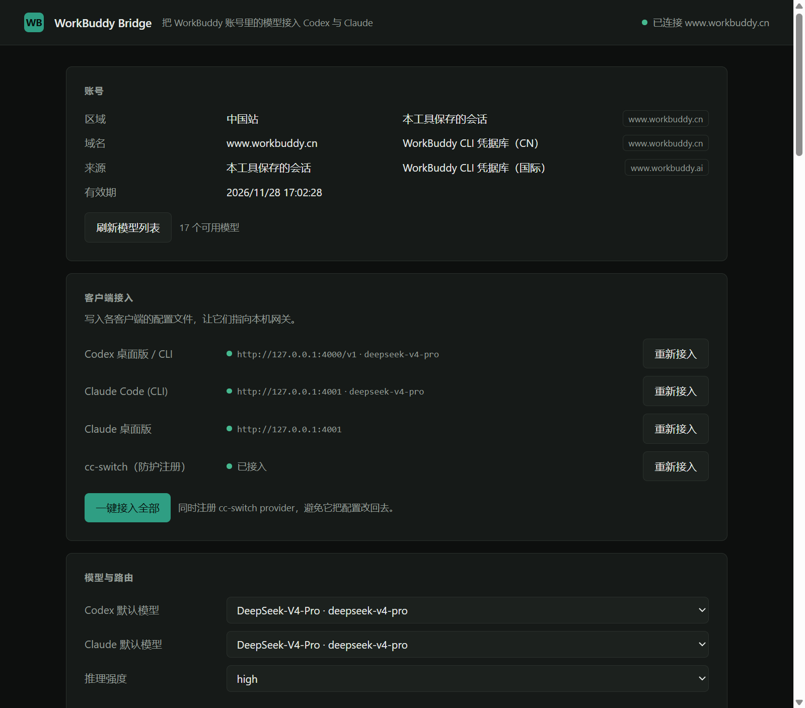

# WorkBuddy Bridge

把腾讯 WorkBuddy 账号里的模型，接进 **Codex** 和 **Claude**（桌面版 + CLI）。

WorkBuddy 本身不提供公开的 OpenAI/Anthropic 兼容接口，Codex 和 Claude 也各说各的协议。这个工具在本机起一个网关：

```
Codex 桌面版 / CLI  ──►  http://127.0.0.1:4000/v1/responses   (OpenAI Responses API)
Claude 桌面版 / CLI  ──►  http://127.0.0.1:4001/v1/messages    (Anthropic Messages API)
                           │
                           ▼
                    WorkBuddy 上游 (/v2/chat/completions)
```

Windows 上是一个**桌面软件**：装完双击打开，配置界面在窗口里，网关跟着程序一起跑，关掉窗口它继续在托盘里待着。



---

## 特性

- **不需要 WorkBuddy 官方 API Key** —— 直接复用桌面客户端已经登录的会话，Token 过期自动刷新。
- **Windows 桌面软件** —— 安装包双击即用，不用装 Node；界面、网关、开机自启都在一个程序里。
- **两个协议各一个端口** —— Codex 只走 Responses API，Claude 只走 Messages API，互不干扰。
- **Claude 桌面版兼容** —— 桌面版只接受 `claude-*` 形式的模型名，工具在网关侧做映射；自动生成 `claude-sonnet-5` / `claude-opus-5` / `claude-fable-5` / `claude-haiku-4-5` 四条路由。
- **模型目录自动同步** —— 把 WorkBuddy 里的模型写进 Codex 的模型目录，桌面版模型选择器里直接能选。
- **cc-switch 保护** —— 如果你装了 cc-switch（会改写同一批配置文件的切换器），工具会注册自己为 provider 并设为当前，避免它把配置改回去。
- **只读本机、回环地址** —— 网关只监听 127.0.0.1，拒绝非回环的 Host / Origin，带 Bearer 令牌。
- **命令行同样可用** —— 桌面软件里改的东西，命令行都能改，两边共用同一套配置文件。

---

## 环境要求

| 项目 | 要求 |
| --- | --- |
| 桌面软件 | Windows 10/11 x64（安装包自带运行时） |
| 账号 | 已安装并登录 WorkBuddy 桌面客户端 |
| 客户端 | Codex、Claude Code 或 Claude 桌面版，可选 |
| 命令行版 | Node.js ≥ 22.5（用到内置 `node:sqlite` 做 cc-switch 保护） |

---

## 安装（Windows 桌面软件）

1. 从 Releases 下载 `WorkBuddy-Bridge-Setup-<版本>.exe`（[v0.1.0](https://github.com/Lingw2/workbuddy-bridge/releases/tag/v0.1.0)）；
2. 双击安装，可自选安装目录，会创建桌面和开始菜单快捷方式；
3. 启动「WorkBuddy Bridge」，窗口里就是配置界面。

软件启动后网关自动在后台跑，窗口关掉它继续在系统托盘待着（托盘图标右键可以重新打开界面或退出）。

### 开机自启

配置界面「网关」区块有「开机自启」开关，勾上之后登录 Windows 时自动启动网关（带 `--hidden`，不弹窗口）。

### 自己构建安装包

```bash
git clone https://github.com/Lingw2/workbuddy-bridge.git
cd workbuddy-bridge
npm install
npm run dist        # 产物在 release/
```

国内网络下载 Electron 二进制可能很慢，可以加镜像：

```bash
ELECTRON_MIRROR=https://npmmirror.com/mirrors/electron/ \
ELECTRON_BUILDER_BINARIES_MIRROR=https://npmmirror.com/mirrors/electron-builder-binaries/ \
npm run dist
```

---

## 命令行版

```bash
git clone https://github.com/Lingw2/workbuddy-bridge.git
cd workbuddy-bridge
npm install

node bin/workbuddy-bridge.js ui     # 网关 + 浏览器打开配置页
```

全局安装：

```bash
npm install -g workbuddy-bridge
workbuddy-bridge ui
```

```bash
workbuddy-bridge ui                # 网关 + 配置页（默认）
workbuddy-bridge start             # 只起网关
workbuddy-bridge status            # 看运行状态和配置状态
workbuddy-bridge doctor            # 自检：账号、客户端、配置、网关
workbuddy-bridge models            # 列出账号可用的模型
workbuddy-bridge install           # 写配置（codex / claude-code / claude-desktop）
workbuddy-bridge install codex cc-switch
workbuddy-bridge uninstall         # 移除写入的配置
```

环境变量：`WORKBUDDY_BRIDGE_UI_PORT`（配置页端口，默认 4477）。

---

## 配置界面能做什么

| 区块 | 作用 |
| --- | --- |
| **账号** | 显示当前登录态（区域 / 域名 / 来源 / 有效期），列出发现的账号文件，点「刷新模型列表」重新拉取。 |
| **客户端接入** | 逐个或一键写入 Codex、Claude Code、Claude 桌面版的配置。 |
| **模型与路由** | 选 Codex / Claude 的默认模型、推理强度；编辑 Claude 路由表（路由名 → WorkBuddy 模型、档位、是否默认）。 |
| **网关** | 查看两个网关是否在跑，修改端口，查看/复制令牌，开机自启开关。 |
| **日志** | 网关最近 200 行日志。 |

「一键接入全部」会做三件事：

1. 写 `~/.codex/config.toml`，加上 `[model_providers.workbuddy]`，并把顶层 `model_provider` 指向它；
2. 写 `~/.claude/settings.json` 的 `env` 块；
3. 写 Claude 桌面版的 3p 配置（`%LOCALAPPDATA%\Claude-3p\configLibrary\...`）。

每一步都会先把原文件复制一份 `.bak-workbuddy-<时间戳>`。

---

## 工作原理

### 1. 凭据从哪来

按顺序找这些位置，找到第一个可用的：

| 位置 | 说明 |
| --- | --- |
| `~/.workbuddy-bridge/session.json` | 本工具自己的缓存 |
| `%LOCALAPPDATA%\CodeBuddyExtension\Data\Public\auth\workbuddy-desktop.info` | WorkBuddy 桌面端登录态 |
| `~/.dsh/workbuddy-vault/cn/*.json` | dsh 插件的凭据库（中国站） |
| `~/.dsh/workbuddy-vault/global/*.json` | dsh 插件的凭据库（国际站） |

拿到 `accessToken` / `refreshToken` 后，Token 快过期时调用 `POST {chatBase}/v2/plugin/auth/token/refresh` 续期，并把新 Token 写回缓存。

### 2. 模型目录

`GET {configBase}/v3/config` 拿到完整目录，再从 `agents[name="cli"]` 里取出 CLI 可用的那批模型。中国站在 `/v3/config` 失败时回落到 `/v2/enterprises/personal/models`。

### 3. 协议转换

- **Responses → chat**：`input[]` 里的 `message` / `function_call` / `function_call_output` 还原成 chat 的 `messages`，`tools[]`（扁平）转成嵌套的 `{type:'function',function:{...}}`。
- **chat → Responses**：上游 SSE 的 `delta.content` / `delta.tool_calls` / `delta.reasoning_content` 翻译成 `response.output_text.delta` / `response.function_call_arguments.delta` / `response.reasoning_summary_text.delta` 等事件。
- **Messages ↔ chat**：Anthropic 的 `system` 数组、`content` typed blocks、`tool_use` / `tool_result`、`thinking` 块与 chat 互转。

### 4. 上游 channel gate

WorkBuddy 上游会检查 `system` / `assistant` 消息的措辞，命中别的 agent 的身份特征就返回 `11128`。实测下来：

- 匹配是**大小写不敏感的任意位置子串匹配**，不是前缀匹配；
- 上游会先规范化不可见字符，所以插零宽空格没用，必须真的改措辞；
- 一条提示里可能命中多处，而且有些命中是「两段拼在一起」才算命中。

Claude Code 的系统提示里有两处会被拒，工具在转发前自动改写：

| 原文 | 改写后 |
| --- | --- |
| `x-anthropic-billing-header:` | `x-request-metadata:` |
| `To give feedback, users should report the issue at https://github.com/anthropics/claude-code/issues` | `To give feedback, users should report the issue to the project maintainers` |

规则在 `src/gateway/rewrite.js`，改上游或换客户端版本时按需增减。

---

## 配置写在哪

| 客户端 | 文件 |
| --- | --- |
| Codex | `~/.codex/config.toml`、`~/.codex/cc-switch-model-catalog.json` |
| Claude Code | `~/.claude/settings.json` |
| Claude 桌面版 | `%LOCALAPPDATA%\Claude-3p\configLibrary\00000000-0000-4000-8000-000000157210.json` |
| cc-switch | `~/.cc-switch/cc-switch.db`（provider 表）、`~/.cc-switch/settings.json`、`~/.cc-switch/live-state.json` |
| 本工具 | `~/.workbuddy-bridge/config.json`、`~/.workbuddy-bridge/session.json` |

桌面软件和命令行版读写的是同一份文件，两边可以混用。

---

## 已知限制

- **只支持 WorkBuddy 桌面端的登录态**。需要先在 WorkBuddy 客户端里登录一次。
- **Codex 0.163.0 只支持 Responses API**。`wire_api = "chat"` 已被官方移除，工具因此自己实现了 `/v1/responses`。
- **Claude 桌面版的 `inferenceModels` 必须是 `claude-*` 形式**，桌面版会拒绝含 `deepseek` / `glm` / `kimi` / `gpt` 等字样的 id。
- **cc-switch 必须在退出状态下才能写它的数据库**。跑着的时候工具会跳过这一步并提示。
- **安装包没有代码签名**，Windows SmartScreen 可能提示未知发布者。
- 工具读写的是别人的账号数据，用在哪儿、怎么用，请自己判断。

---

## 开发

```bash
npm test                   # 协议转换的单元测试
npm run smoke              # 对着真实网关跑一轮端到端
npm run desktop            # 开发模式启动桌面软件
npm run icon               # 重新生成图标
node bin/workbuddy-bridge.js doctor
```

目录结构：

```
bin/            CLI 入口
desktop/        Electron 桌面外壳：窗口、托盘、开机自启
src/app.js      应用容器：网关、模型、UI
src/upstream/   WorkBuddy 上游：凭据、模型目录、SSE
src/gateway/    协议转换层：Anthropic / Responses / 改写
src/config/     客户端配置读写：Codex / Claude / cc-switch / TOML
src/ui/         配置页（原生 HTML + JS，无构建步骤）
test/           测试
tools/          图标生成、截图、诊断脚本
```

图标是脚本画出来的（`tools/make-icon.mjs`，手写 PNG 编码器），仓库里不放二进制素材，改配色重跑脚本即可。

## License

MIT，见 [LICENSE](LICENSE)。
