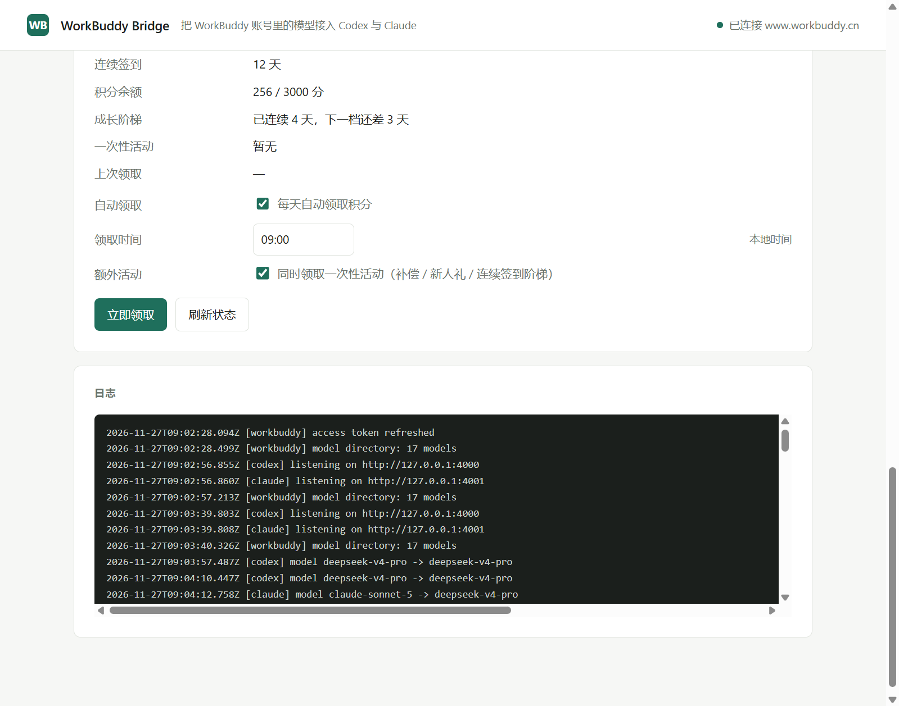
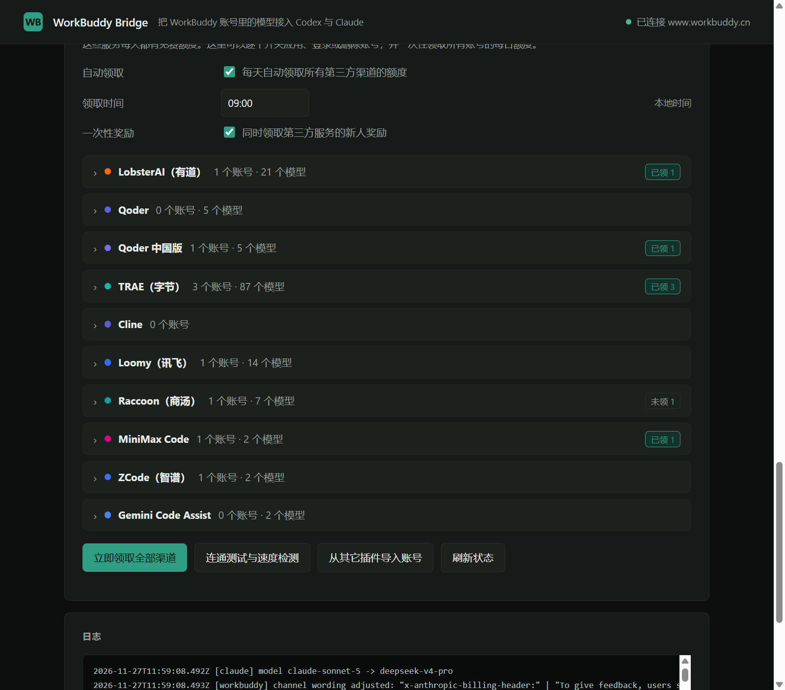
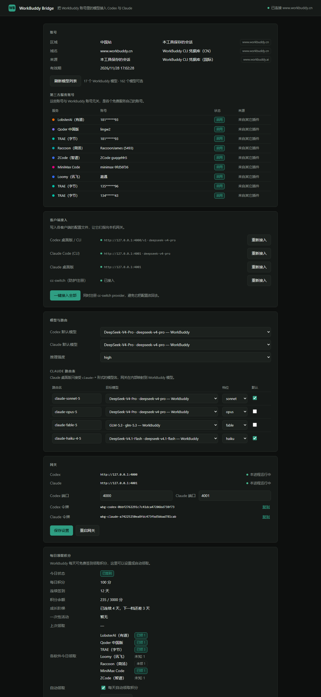

# WorkBuddy Bridge

把腾讯 WorkBuddy 账号里的模型，接进 **Codex** 和 **Claude**（桌面版 + CLI）。

WorkBuddy 本身不提供公开的 OpenAI/Anthropic 兼容接口，Codex 和 Claude 也各说各的协议。这个工具在本机起一个网关：

```
Codex 桌面版 / CLI  ──►  http://127.0.0.1:4000/v1/responses   (OpenAI Responses API)
Claude 桌面版 / CLI  ──►  http://127.0.0.1:4001/v1/messages    (Anthropic Messages API)
                           │
                           ▼
                    WorkBuddy 上游 (/v2/chat/completions)
```

Windows 上是一个**桌面软件**：装完双击打开，配置界面在窗口里，网关跟着程序一起跑，关掉窗口它继续在托盘里待着。


每天的积分也能在同一个界面里领：



第三方免费渠道（LobsterAI、Qoder、TRAE、Loomy、MiniMax、ZCode 等）的每日额度也一起管：



所有渠道的模型汇总成一份目录，按厂商分组显示：



---

## 特性

- **不需要 WorkBuddy 官方 API Key** —— 直接复用桌面客户端已经登录的会话，Token 过期自动刷新。
- **Windows 桌面软件** —— 安装包双击即用，不用装 Node；界面、网关、开机自启都在一个程序里。
- **两个协议各一个端口** —— Codex 只走 Responses API，Claude 只走 Messages API，互不干扰。
- **Claude 桌面版兼容** —— 桌面版只接受 `claude-*` 形式的模型名，工具在网关侧做映射；自动生成 `claude-sonnet-5` / `claude-opus-5` / `claude-fable-5` / `claude-haiku-4-5` 四条路由。
- **模型目录自动同步** —— 把 WorkBuddy 里的模型写进 Codex 的模型目录，桌面版模型选择器里直接能选。
- **cc-switch 保护** —— 如果你装了 cc-switch（会改写同一批配置文件的切换器），工具会注册自己为 provider 并设为当前，避免它把配置改回去。
- **每天自动领积分** —— WorkBuddy 每天签到可以免费拿积分，工具能按你设定的时间自动签到、领取一次性活动、兑换连续签到阶梯。
- **第三方免费渠道** —— LobsterAI、Qoder（国际/中国版）、TRAE、Cline、Loomy、Raccoon、MiniMax Code、ZCode、Gemini Code Assist 十个服务的账号集中管理：逐个开关应用、增删账号、每天自动领所有账号的额度，还能做连通测试和速度检测。
- **聚合模型目录** —— WorkBuddy 加上十个第三方服务的模型收进一份目录（实测 162 个），按厂商（DeepSeek / 智谱 GLM / Kimi / 豆包 / Qwen / MiniMax / Gemini …）分组显示，模型下拉里能一眼看出是哪个厂商、哪个服务提供的。
- **一键登录** —— 点某个服务的「一键登录」就打开官网登录页，登录完成后工具自己把凭据读回来，账号自动出现，不用手抄 token。
- **每个服务单独选模型** —— 每个服务下面列着自己的模型，可以逐个禁用，也能指定这个服务默认用哪个模型。
- **全自动客户端植入** —— 网关一启动就自己认出机器上装了哪些客户端并写好配置，新机器上不用手动点一遍。
- **只读本机、回环地址** —— 网关只监听 127.0.0.1，拒绝非回环的 Host / Origin，带 Bearer 令牌。
- **命令行同样可用** —— 桌面软件里改的东西，命令行都能改，两边共用同一套配置文件。

---

## 环境要求

| 项目 | 要求 |
| --- | --- |
| 桌面软件 | Windows 10/11 x64（安装包自带运行时） |
| 账号 | 已安装并登录 WorkBuddy 桌面客户端 |
| 客户端 | Codex、Claude Code 或 Claude 桌面版，可选 |
| 命令行版 | Node.js ≥ 22.5（用到内置 `node:sqlite` 做 cc-switch 保护） |

---

## 安装（Windows 桌面软件）

1. 从 Releases 下载 `WorkBuddy-Bridge-Setup-<版本>.exe`（[v0.4.0](https://github.com/Lingw2/workbuddy-bridge/releases/tag/v0.4.0)）；
2. 双击安装，可自选安装目录，会创建桌面和开始菜单快捷方式；
3. 启动「WorkBuddy Bridge」，窗口里就是配置界面。

软件启动后网关自动在后台跑，窗口关掉它继续在系统托盘待着（托盘图标右键可以重新打开界面或退出）。

### Windows 提示「未知发布者」？

安装包没有做代码签名（要签名得买证书，这项目没买），SmartScreen 会拦一下：

```
Windows 已保护你的电脑   →   更多信息   →   仍要运行
```

只想让这一台机器不再提示，可以右键安装包 →「属性」→ 底部勾上「解除锁定」→ 确定，再运行。

### 开机自启

配置界面「网关」区块有「开机自启」开关，勾上之后登录 Windows 时自动启动网关（带 `--hidden`，不弹窗口）。

### 自己构建安装包

```bash
git clone https://github.com/Lingw2/workbuddy-bridge.git
cd workbuddy-bridge
npm install
npm run dist        # 产物在 release/
```

国内网络下载 Electron 二进制可能很慢，可以加镜像：

```bash
ELECTRON_MIRROR=https://npmmirror.com/mirrors/electron/ \
ELECTRON_BUILDER_BINARIES_MIRROR=https://npmmirror.com/mirrors/electron-builder-binaries/ \
npm run dist
```

---

## 命令行版

```bash
git clone https://github.com/Lingw2/workbuddy-bridge.git
cd workbuddy-bridge
npm install

node bin/workbuddy-bridge.js ui     # 网关 + 浏览器打开配置页
```

全局安装：

```bash
npm install -g workbuddy-bridge
workbuddy-bridge ui
```

```bash
workbuddy-bridge ui                # 网关 + 配置页（默认）
workbuddy-bridge start             # 只起网关
workbuddy-bridge status            # 看运行状态和配置状态
workbuddy-bridge doctor            # 自检：账号、客户端、配置、网关
workbuddy-bridge models            # 列出账号可用的模型
workbuddy-bridge catalog           # 列出所有服务的模型，按厂商分组
workbuddy-bridge install           # 写配置（codex / claude-code / claude-desktop）
workbuddy-bridge install codex cc-switch
workbuddy-bridge uninstall         # 移除写入的配置
workbuddy-bridge credit            # 看今天的签到状态、余额、可兑换阶梯
workbuddy-bridge claim             # 立刻把所有还开着的积分通道领一遍
workbuddy-bridge channels          # 看第三方渠道的账号和今天的领取状态
workbuddy-bridge channels-claim    # 一次性领完所有渠道所有账号的每日额度
workbuddy-bridge channels-probe    # 连通测试 + 速度检测
```

环境变量：`WORKBUDDY_BRIDGE_UI_PORT`（配置页端口，默认 4477）。

---

## 配置界面能做什么

| 区块 | 作用 |
| --- | --- |
| **账号** | 显示当前登录态（区域 / 域名 / 来源 / 有效期）与发现的账号文件；下面是第三方服务账号，按服务折叠，点开看该服务的全部账号。 |
| **客户端接入** | 逐个或一键写入 Codex、Claude Code、Claude 桌面版的配置。 |
| **模型与路由** | 选 Codex / Claude 的默认模型、推理强度；编辑 Claude 路由表（路由名 → 目标模型、档位、是否默认）。 |
| **每日领取积分** | 显示今天的签到状态、每日积分、连续天数、余额、可兑换阶梯；设置每天自动领取的时间和开关；点「立即领取 WorkBuddy 积分」手动领一次。 |
| **第三方免费渠道** | 十个第三方服务按服务折叠：一行看清「几个账号 · 几个模型 · 今天领了没」，展开后有开关、一键登录、账号表格和该服务的模型清单（可逐个禁用、可指定默认模型）。 |
| **网关** | 查看两个网关是否在跑，修改端口，查看/复制令牌，开机自启开关。 |
| **日志** | 网关最近 200 行日志。 |

**折叠起来看更清楚。** 第三方账号与模型数量很多，界面把它们按服务折叠起来：收起时一行只有一个服务名和几个数字，展开才看到账号表格和模型清单。折叠状态会被记住，页面每 5 秒刷新一次也不会把展开的分组关掉。

「一键接入全部」会做三件事：

1. 写 `~/.codex/config.toml`，加上 `[model_providers.workbuddy]`，并把顶层 `model_provider` 指向它；
2. 写 `~/.claude/settings.json` 的 `env` 块；
3. 写 Claude 桌面版的 3p 配置（`%LOCALAPPDATA%\Claude-3p\configLibrary\...`）。

每一步都会先把原文件复制一份 `.bak-workbuddy-<时间戳>`。

**不用手动点。** 网关每次启动都会自己扫一遍机器上装了哪些客户端，已经接好的跳过，没接的写好 —— 新机器上装完软件直接用就行。不想让它自动改配置，可以在 `config.json` 里把 `autoInstall` 设成 `false`，或者在界面上关掉对应的客户端。

---

## 工作原理

### 1. 凭据从哪来

按顺序找这些位置，找到第一个可用的：

| 位置 | 说明 |
| --- | --- |
| `~/.workbuddy-bridge/session.json` | 本工具自己的缓存 |
| `%LOCALAPPDATA%\CodeBuddyExtension\Data\Public\auth\workbuddy-desktop.info` | WorkBuddy 桌面端登录态 |
| `~/.dsh/workbuddy-vault/cn/*.json` | dsh 插件的凭据库（中国站） |
| `~/.dsh/workbuddy-vault/global/*.json` | dsh 插件的凭据库（国际站） |

拿到 `accessToken` / `refreshToken` 后，Token 快过期时调用 `POST {chatBase}/v2/plugin/auth/token/refresh` 续期，并把新 Token 写回缓存。

### 2. 模型目录

`GET {configBase}/v3/config` 拿到完整目录，再从 `agents[name="cli"]` 里取出 CLI 可用的那批模型。中国站在 `/v3/config` 失败时回落到 `/v2/enterprises/personal/models`。

### 3. 协议转换

- **Responses → chat**：`input[]` 里的 `message` / `function_call` / `function_call_output` 还原成 chat 的 `messages`，`tools[]`（扁平）转成嵌套的 `{type:'function',function:{...}}`。
- **chat → Responses**：上游 SSE 的 `delta.content` / `delta.tool_calls` / `delta.reasoning_content` 翻译成 `response.output_text.delta` / `response.function_call_arguments.delta` / `response.reasoning_summary_text.delta` 等事件。
- **Messages ↔ chat**：Anthropic 的 `system` 数组、`content` typed blocks、`tool_use` / `tool_result`、`thinking` 块与 chat 互转。

### 4. 上游 channel gate
WorkBuddy 上游会检查 `system` / `assistant` 消息的措辞，命中别的 agent 的身份特征就返回 `11128`。实测下来：

- 匹配是**大小写不敏感的任意位置子串匹配**，不是前缀匹配；
- 上游会先规范化不可见字符，所以插零宽空格没用，必须真的改措辞；
- 一条提示里可能命中多处，而且有些命中是「两段拼在一起」才算命中。

Claude Code 的系统提示里有两处会被拒，工具在转发前自动改写：

| 原文 | 改写后 |
| --- | --- |
| `x-anthropic-billing-header:` | `x-request-metadata:` |
| `To give feedback, users should report the issue at https://github.com/anthropics/claude-code/issues` | `To give feedback, users should report the issue to the project maintainers` |

规则在 `src/gateway/rewrite.js`，改上游或换客户端版本时按需增减。

### 5. 每日自动领取积分

WorkBuddy 的积分走 `https://www.codebuddy.cn`（国际站是 `https://www.workbuddy.ai`）这套 billing 接口，和聊天接口不是同一个 host。工具复用同一份登录态，调用的端点有：

| 通道 | 接口 | 说明 |
| --- | --- | --- |
| **每日签到** | `POST /v2/billing/meter/daily-checkin` | 每天 100 积分，连续签到有 streak 计数。**上游是幂等的**，当天重复调用只会返回「今天已签到，请明天再来」。 |
| 签到状态 | `POST /v2/billing/meter/checkin-activity-status` | `today_checked_in` 决定今天还需不需要领。 |
| 补偿活动 | `POST /billing/meter/claim-compensation` | 一次性活动，上游自己开关。 |
| 新人礼 | `POST /billing/meter/claim-gift` | 每人一次。 |
| 连续签到阶梯 | `POST /activity/growth/redeem` | 7/14/28 天档，14 天给 50 分、28 天给 150 分，只有上游标成 `available` 的档才能兑。 |
| Buddy 旅行奖励 | `POST /v2/activity/growth/buddy/travel/claim` | 由消息中心 `growth.travel_arrival` 消息触发。 |
| 余额 | `POST /v2/billing/meter/get-user-resource` | 积分包列表，能看到每个包的发来源（`daily_checkin` / `welcome_gift` 等）。 |

自动领取的逻辑在 `src/credit/service.js`：

- 按**本地日历日**切分，跨零点自动开始新的一天；
- 先查 `today_checked_in`，已签就跳过，不去打扰上游；
- 每个通道互相独立 —— 一次性活动挂了不影响每日签到；
- 失败按 1/5/15/30/60 分钟退避重试，不硬打；
- 状态存在 `~/.workbuddy-bridge/credit-state.json`，进程重启也不会重复领。

配置界面「每日领取积分」区块可以设置时间（本地时间，默认 09:00）和开关，也可以点「立即领取」手动领一次。

### 6. 第三方免费渠道

除了 WorkBuddy 自己，还有十家服务每天送免费额度。工具把它们接进来，账号和领取逻辑都在 `src/channels/`：

| 服务 | 官方 | 每日签到 | 额度查询 |
| --- | --- | --- | --- |
| LobsterAI（有道） | [lobsterai.youdao.com](https://lobsterai.youdao.com) | ✅ | ✅ |
| Qoder（国际） | [qoder.com](https://qoder.com) | ✅ | ✅ |
| Qoder 中国版 | [qoder.cn](https://qoder.cn) | ✅ | ✅ |
| TRAE（字节） | [trae.cn](https://www.trae.cn) | ✅ | ✅ |
| Cline | [cline.bot](https://cline.bot) | — | ✅ |
| Loomy（讯飞） | [loomy.xunfei.cn](https://loomy.xunfei.cn) | ✅ | ✅ |
| Raccoon（商汤） | [xiaohuanxiong.com](https://xiaohuanxiong.com) | — | ✅ |
| MiniMax Code | [account.minimax.cn](https://account.minimax.cn) | ✅ | ✅ |
| ZCode（智谱） | [zcode.z.ai](https://zcode.z.ai) | ⚠️ | ✅ |
| Gemini Code Assist | [codeassist.google](https://codeassist.google) | — | ✅ |

各家实际调用的端点：

| 服务 | 签到状态 | 领取 | 余额 |
| --- | --- | --- | --- |
| LobsterAI | `GET /api/client-activities/slot` → `GET /api/client-activities/{code}/context` | `POST /api/client-activities/{code}/actions/check_in` | `GET /api/user/profile-summary` |
| Qoder / Qoder CN | `GET /sash/api/v1/me/campaigns` | `POST /sash/api/v1/me/campaigns/{id}/claim` | `GET /sash/api/v2/me/usage` |
| TRAE | `POST /trae/api/v2/ug/checkin_credits/status` | `POST /trae/api/v2/ug/checkin_credits/claim` | `POST /trae/api/v2/pay/ide_user_ent_usage` |
| Loomy | `POST /points/first-login` | `POST /points/first-login` | `GET /points/records` |
| MiniMax Code | `GET /minimax-cloud/api/v1/signin/status` | `POST /minimax-cloud/api/v1/signin/claim` | `GET /minimax-cloud/api/v1/credit/details` |
| ZCode | `GET /api/v1/zcode-plan/billing/preview` | `POST /api/v1/zcode-plan/billing/claim` | `GET /api/v1/zcode-plan/billing/balance` |
| Cline | — | — | `GET /api/v1/users/me/plan/usage-limits` |
| Gemini | — | — | `GET /v1internal:retrieveUserQuotaSummary` |
| Raccoon | — | `POST /api/web/desktop/v1/login/points/grant`（新人礼） | `GET /api/web/points/v1/balance` |

特点：

- **多账号**：每个服务可以加任意多个账号，「立即领取全部」会把所有服务的所有账号挨个领一遍；
- **逐个删**：不想留的账号在界面上点「删除」即可，删掉的账号不会被「从其它插件导入」再带回来；
- **可开关**：应用级别和账号级别都能停用，停用的不参与领取；
- **一键登录**：点服务上的「一键登录」打开官网登录页，工具在后台守着回调，登录好了自动把账号收进来（账号行里不再有单独的登录按钮）。
- **连通测试与速度检测**：每个账号连打三次取往返时间，分「很快 / 正常 / 偏慢 / 不通」；
- **自动领取**：和 WorkBuddy 积分一样按本地日切分，同一天只跑一次，失败按 1/5/15/30/60 分钟退避；
- **按服务折叠**：账号和模型都不平铺，界面上一个服务一行（账号数 · 模型数 · 今天领了没），展开才看到细节。

账号存在 `~/.workbuddy-bridge/channel-accounts.json`，领取状态存在 `~/.workbuddy-bridge/channel-claim-state.json`。

⚠️ **ZCode 的领取端点始终要人机验证**（上游返回 `captcha verify failed`，且校验在套餐检查之前），工具会明确提示「需要在官网手动领取」，不会去绕验证码。

---

### 7. 聚合模型目录

WorkBuddy 的模型和十个第三方服务的模型收在同一份目录里。模型 id 用 `服务/模型` 的形式（`trae/deepseek-v4-pro`、`lobsterai/deepseek-v4-pro`），网关按前缀把它路由到对应服务：

| 服务 | 模型目录来源 | 对话接口 |
| --- | --- | --- |
| WorkBuddy | `GET /v2/models`（账号目录） | `POST /v2/chat/completions` |
| LobsterAI | `GET /api/models/available` | `POST /api/proxy/v1/chat/completions` |
| Qoder / Qoder CN | 无公开目录，用内置兜底表 | — |
| TRAE | `POST /api/ide/v1/batch_get_detail_param` | `POST /api/agent/v3/llm_utils_chat` |
| Cline | `GET /api/v1/models` | `POST /api/v1/chat/completions` |
| Loomy | `GET /models` | `POST /chat/completions` |
| Raccoon | `GET /api/web/llm/v2/model_catalog` | `POST /api/web/llm/v2/chat/completions` |
| MiniMax Code | `GET /mavis/api/v1/models` | `POST /mavis/api/v1/llm/v1/messages` |
| ZCode | `GET /api/v1/client/configs` | `POST /api/v1/zcode-plan/anthropic/v1/messages` |
| Gemini | 无公开目录，用内置兜底表 | — |

界面上：

- **模型下拉按厂商分组** —— `optgroup` 的标题就是厂商名，选项写成「模型名 · 服务/标识 — 来源服务」，例如 `DeepSeek-V4-Pro · trae/deepseek-v4-pro — TRAE（字节）`；
- **厂商归属自动识别** —— 按模型名里的关键词归到 18 个已知厂商（DeepSeek、智谱 GLM、Kimi、豆包、Qwen、MiniMax、Gemini、Claude、GPT、MiMo、Step、日日新、星火…），认不出来的归到「其他厂商」；
- **逐个禁用模型** —— 每个服务下面列着自己能用的模型（折叠在「模型」一行里），可以单独禁用（`config.channels.disabledModels`），也能整个服务关掉（`config.channels.disabledProviders`）；
- **每个服务默认模型** —— `config.channels.providerModels` 指定某服务优先用哪个模型。

各家的对话协议不一样（OpenAI 形状的、SOLO 形状的、Anthropic 形状的），工具在 `src/channels/chat.js` 里各自转换，上游报的错（比如 ZCode 的 `exceed quota limit`）会原样透出来。

---

## 配置写在哪

| 客户端 | 文件 |
| --- | --- |
| Codex | `~/.codex/config.toml`、`~/.codex/cc-switch-model-catalog.json` |
| Claude Code | `~/.claude/settings.json` |
| Claude 桌面版 | `%LOCALAPPDATA%\Claude-3p\configLibrary\00000000-0000-4000-8000-000000157210.json` |
| cc-switch | `~/.cc-switch/cc-switch.db`（provider 表）、`~/.cc-switch/settings.json`、`~/.cc-switch/live-state.json` |
| 本工具 | `~/.workbuddy-bridge/config.json`、`~/.workbuddy-bridge/session.json`、`~/.workbuddy-bridge/credit-state.json`、`~/.workbuddy-bridge/channel-accounts.json`、`~/.workbuddy-bridge/channel-claim-state.json` |

桌面软件和命令行版读写的是同一份文件，两边可以混用。

---

## 已知限制

- **只支持 WorkBuddy 桌面端的登录态**。需要先在 WorkBuddy 客户端里登录一次。
- **Codex 0.163.0 只支持 Responses API**。`wire_api = "chat"` 已被官方移除，工具因此自己实现了 `/v1/responses`。
- **Claude 桌面版的 `inferenceModels` 必须是 `claude-*` 形式**，桌面版会拒绝含 `deepseek` / `glm` / `kimi` / `gpt` 等字样的 id。
- **cc-switch 必须在退出状态下才能写它的数据库**。跑着的时候工具会跳过这一步并提示。
- **积分活动以官方为准**。一次性活动（补偿 / 新人礼）由上游自己开关，工具只在上游说还开着的时候去领；连续签到阶梯只有满 7/14/28 天才解锁。工具不会绕过任何规则。
- **ZCode 的每日领取要人机验证**，上游强制校验，工具会提示去官网手动领。
- **Cline / Raccoon / Gemini 没有每日签到接口**，工具只查额度。Raccoon 的一次性登录奖励会去领。
- **Qoder 与 Gemini 没有公开的模型目录接口**，工具用内置的兜底模型表；Qoder 中国版也没有可用的公开 OpenAI 兼容推理端点，所以它的模型只能看、不能调。
- **Gemini 的「一键登录」需要你自己的 OAuth 凭据**。工具不内置 Google 的 client id / secret，请设置 `WORKBUDDY_BRIDGE_GEMINI_CLIENT_ID` 与 `WORKBUDDY_BRIDGE_GEMINI_CLIENT_SECRET`（用 Gemini 桌面应用自己那一套）。其它服务不需要额外配置。
- **TRAE 的模型只能在它自己列出的通道里调用**，发到别的通道上游会拒绝；工具按模型目录里记录的通道发请求。
- **安装包没有代码签名**，Windows SmartScreen 会提示未知发布者（见上面「Windows 提示『未知发布者』？」）。
- 工具读写的是别人的账号数据，用在哪儿、怎么用，请自己判断。

---

## 开发

```bash
npm test                   # 协议转换 + 积分流程 + 第三方渠道 + 聚合目录的单元测试
npm run smoke              # 对着真实网关跑一轮端到端
npm run desktop            # 开发模式启动桌面软件
npm run icon               # 重新生成图标
node bin/workbuddy-bridge.js doctor
```

目录结构：

```
bin/            CLI 入口
desktop/        Electron 桌面外壳：窗口、托盘、开机自启
src/app.js      应用容器：网关、模型、积分、渠道、UI
src/upstream/   WorkBuddy 上游：凭据、模型目录、SSE、积分接口
src/credit/     每日自动领取积分：调度器、状态落盘
src/channels/   第三方免费渠道：签到、账号库、调度器、连通检测、模型目录、登录流程、目录聚合
src/gateway/    协议转换层：Anthropic / Responses / 改写
src/config/     客户端配置读写：Codex / Claude / cc-switch / TOML
src/ui/         配置页（原生 HTML + JS，无构建步骤）
test/           测试
tools/          图标生成、截图、诊断脚本
```

图标是脚本画出来的（`tools/make-icon.mjs`，手写 PNG 编码器），仓库里不放二进制素材，改配色重跑脚本即可。

## License

MIT，见 [LICENSE](LICENSE)。
