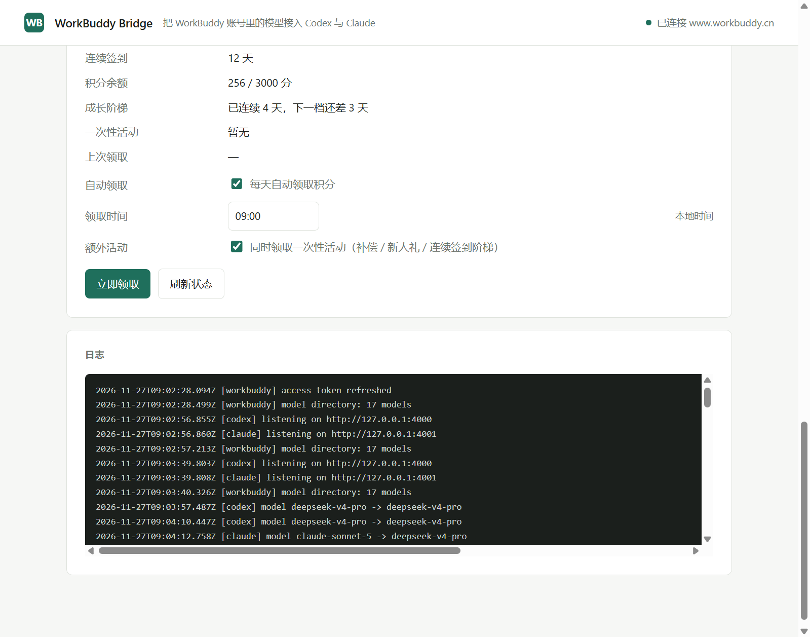

Adds daily automatic WorkBuddy credit claiming on top of the model bridge.

## What is new

- **Claims your WorkBuddy credits every day.** The billing endpoints live on a different host than the chat API, so the app now talks to them directly: the daily check-in (100 credits a day), one-off compensation campaigns, the welcome gift, the 7/14/28-day streak tiers and the Buddy travel reward.
- **A new section in the configuration screen** shows today's status, the daily credit, the current streak, the balance, the next streak tier and the last claim. You can switch automatic claiming on or off, pick the time of day, and claim right now.
- **Two new commands**: `workbuddy-bridge credit` prints the status, `workbuddy-bridge claim` claims everything that is still open.
- **It never claims twice.** The app asks the upstream whether today has already been claimed before writing anything, days are split by the local calendar, and the state is kept in `~/.workbuddy-bridge/credit-state.json` so a restart does not spend another claim.
- **Failures back off** instead of hammering the upstream, and each channel is independent, so an expired one-off campaign cannot block the daily check-in.

## Screenshots

The credit section of the configuration screen:

## Upgrade

Download the new installer below and run it over the old version. Your configuration and login state are kept.
